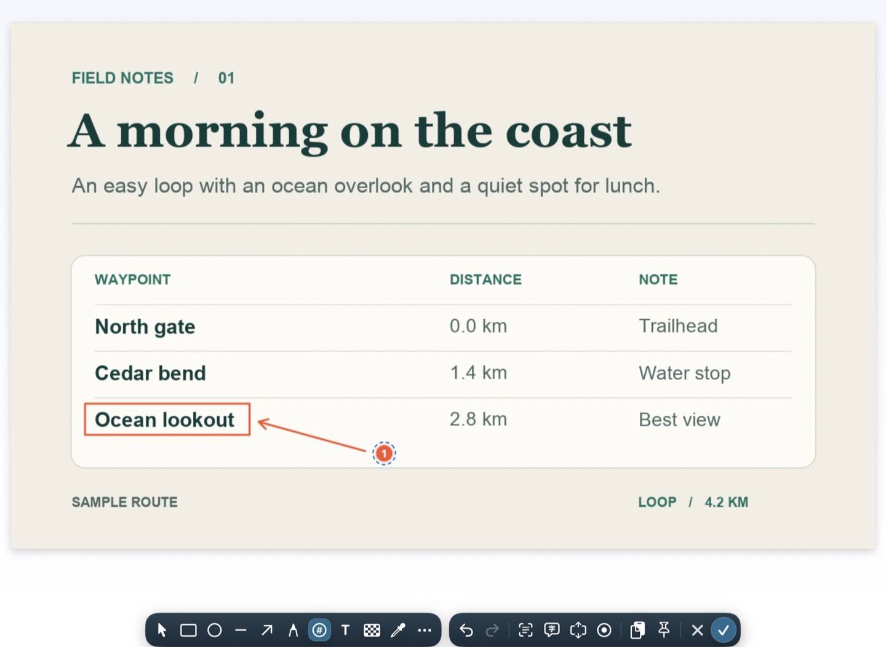
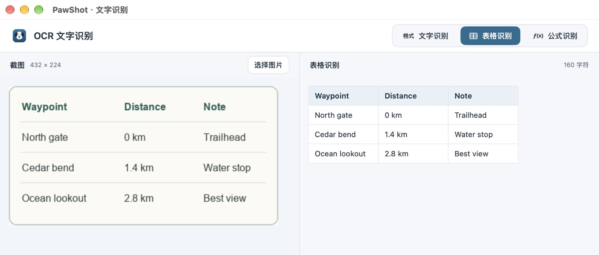
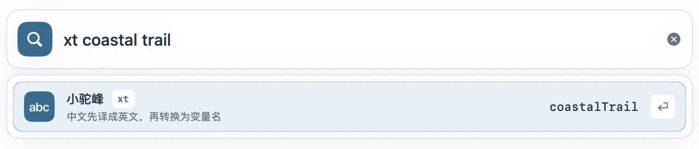

# PawShot

**English** · [简体中文](README.zh-CN.md)

PawShot is a native macOS menu bar app for screenshots, screen recording, OCR, translation, and clipboard history. Capture what you need, mark it up, and paste it back into your work.

**[Download the latest release](https://github.com/youcanyoudonocannobb/shiguang-screenshot/releases/latest)** · macOS 15 or later · Apple silicon

## What you can do

- **Capture and annotate** Select an area or click a window. Add arrows, numbers, text, and mosaic masks. Select existing marks to edit them. Confirm to copy the result, or pin it directly to your desktop.
- **Record and stitch** Record a region as a silent MP4 or GIF, with pause and resume. Take a scrolling screenshot manually or automatically, preview the stitched image, and copy it when you're done.
- **Read and translate** Extract text, tables, and simple formulas on device. Translate a screenshot, the clipboard, or selected text in a popup. Use Apple Translation by default or configure an AI service compatible with OpenAI Chat, OpenAI Responses, Claude Messages, or Gemini.
- **Search and reuse** Find past clipboard items by text or type. Use the launcher to search apps, prefix a query with `/` to find files, or generate variable names and test data. The toolbox handles JSON, Base64, and other conversions.
- **Work in Finder** Use the Finder extension to create files, copy paths, compress or extract archives, jump to favorite folders, and open files or folders with your chosen apps.

## PawShot in action

### Table OCR

The original image stays on the left while PawShot rebuilds the table on the right. Copy the result as Markdown or export it as CSV.

### Launcher

Type `xt coastal trail` to generate `coastalTrail`. Press Return to copy it.

## Install and get started

1. Download the DMG from the [latest release](https://github.com/youcanyoudonocannobb/shiguang-screenshot/releases/latest) and drag `PawShot.app` into Applications.
2. Open PawShot and click the dog icon in the menu bar or press `⌥⇧S` to start a capture. Allow screen recording when macOS prompts you. Selected-text translation and automatic scrolling capture also need Accessibility permission.
3. Open **Settings → General** to choose English, Simplified Chinese, Japanese, or Korean and customize the menu bar icon.
4. To use Finder actions, open **Settings → Finder Actions → System Settings** and enable the PawShot Finder extension. Grant Full Disk Access only if you need actions in protected folders.

## Default global shortcuts

| Action | Shortcut |
| --- | --- |
| Capture a region | `⌥⇧S` |
| Capture and translate | `⌥⇧T` |
| Clipboard history | `⌥⇧V` |
| Translate the clipboard | `⌥⇧C` |
| Translate selected text | `⌥⇧D` |
| Launcher | `⌥⇧X` |

Customize these shortcuts in **Settings → Shortcuts**. Press Esc to cancel a selection or discard the current draft.

## Privacy and settings

OCR runs on device. Screenshot and clipboard history are stored locally. When you use optional AI translation, the text you translate is sent to the service you configured. Copied screenshots include mosaic masks and other marks. The original remains editable in screenshot history.

The current source supports importing and exporting JSON settings under **Settings → General → Configuration backup**. Backups exclude API keys, history, and macOS permissions.

## Development and feedback

Built with SwiftUI and AppKit. [Build, test, and package](docs/BUILDING.md) · [Report an issue](https://github.com/youcanyoudonocannobb/shiguang-screenshot/issues)
