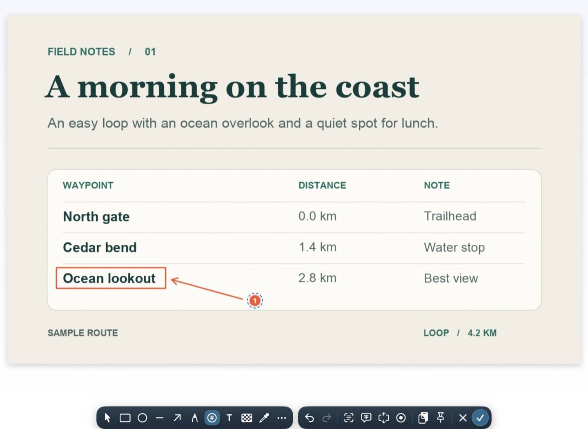
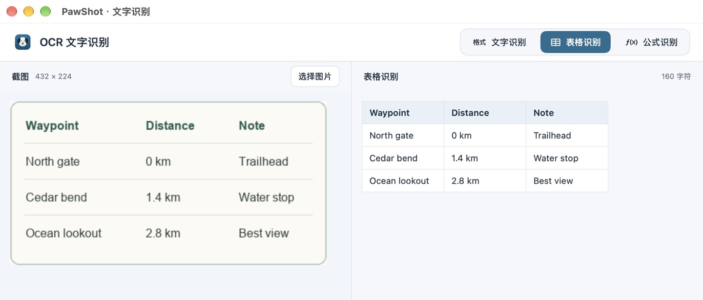
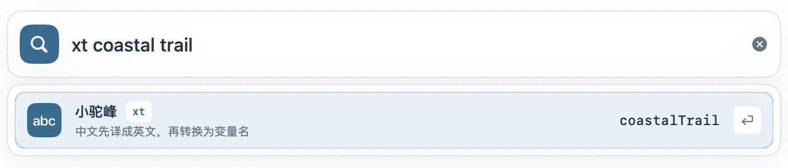

# PawShot

[English](README.md) · **简体中文**

PawShot 是一款原生 macOS 菜单栏工具。框选屏幕、编辑截图、录制 MP4 或 GIF，也能识别图中文字、翻译选中文本和找回剪贴板内容。

**[下载最新版](https://github.com/youcanyoudonocannobb/shiguang-screenshot/releases/latest)** · 需要 macOS 15 或以上及 Apple 芯片

## 主要功能

- **截图与标注** 在屏幕上框选区域或点选窗口。箭头、编号、文字和马赛克等标注可以重新选中编辑。确认后复制到系统剪贴板，也可以直接钉在桌面上。
- **录制与长截图** 录制无声 MP4 或 GIF，支持暂停与继续。长截图支持手动或自动滚动、实时查看拼接预览，完成后直接复制。
- **识别与翻译** 在本机识别文字、表格和简单公式。支持截图翻译、剪贴板翻译和划词弹窗。默认使用 Apple 翻译，也可配置兼容 OpenAI Chat、OpenAI Responses、Claude Messages 或 Gemini 协议的 AI 服务。
- **剪贴板与启动台** 搜索及筛选文字、图片、GIF、视频和文件历史。启动台可以搜索应用，输入 `/` 搜索文件，也可以生成变量名和测试数据。工具箱支持 JSON、Base64 等格式的转换。
- **超级右键** 在访达中创建文件、复制路径、压缩或解压、打开常用目录，也能用自己选定的应用打开文件或文件夹。

## 实机截图

### 表格识别

左侧显示原图，右侧显示本机识别出的表格。结果可复制为 Markdown，也可导出 CSV。

### 启动台

输入 `xt coastal trail` 生成 `coastalTrail`，按回车即可复制。

## 安装与使用

1. 在[最新版发布页](https://github.com/youcanyoudonocannobb/shiguang-screenshot/releases/latest)下载 DMG，将 `PawShot.app` 拖到「应用程序」。
2. 打开 PawShot，点击菜单栏的小狗图标或按 `⌥⇧S` 开始截图。首次录屏或截图时按 macOS 提示授予屏幕录制权限。划词翻译和自动长截图还需要「辅助功能」权限。
3. 在「偏好设置 → 通用」可切换简体中文、English、日本語或 한국어，也可自定义菜单栏图标。
4. 如需访达右键功能，在「偏好设置 → 超级右键」点击「系统设置」，启用 PawShot 访达扩展。访问系统保护的目录时，按需授予「完整磁盘访问」权限。

## 默认全局快捷键

| 操作 | 快捷键 |
| --- | --- |
| 区域截图 | `⌥⇧S` |
| 截图并翻译 | `⌥⇧T` |
| 剪贴板历史 | `⌥⇧V` |
| 翻译剪贴板 | `⌥⇧C` |
| 划词翻译 | `⌥⇧D` |
| 启动台 | `⌥⇧X` |

可在「偏好设置 → 快捷键」修改这些组合键。按 Esc 可取消当前框选或草稿。

## 隐私与配置

OCR 在本机执行，截图和剪贴板历史也在本机保存。使用可选的 AI 翻译时，待翻译文字会发给你配置的服务。复制的截图会合并马赛克等标注，截图历史中的原图仍可编辑。

当前源码支持在「偏好设置 → 通用 → 配置备份」导入或导出 JSON 设置。备份不包含 API Key、历史内容或 macOS 授权。

## 开发与反馈

使用 SwiftUI 和 AppKit 构建。[编译、测试与打包](docs/BUILDING.md) · [问题反馈](https://github.com/youcanyoudonocannobb/shiguang-screenshot/issues)
